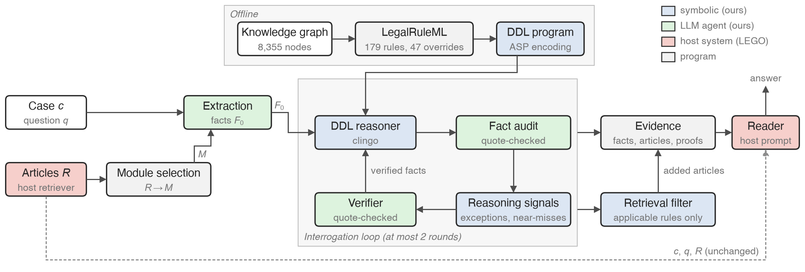

# LexReact

**LexReact** (*Legal RuleML-guided Agents for Checking and reTrieval*) is a multi-agent pipeline for Chinese
civil-law QA. LLM agents extract, audit and verify facts and write the final answer; a **defeasible deontic reasoner
over LegalRuleML** coordinates them and filters retrieval. The reasoner does not answer the question. Instead, it

1. **audits** the LLM-extracted facts that its conclusions depend on;
2. **asks** questions that can be checked against the case text: unverified exceptions, rules that miss one fact,
   and rules outside the retrieved articles. Answers are accepted only with a verbatim quote from the case;
3. **adds** an article to the retrieved set only if its rule is applicable and undefeated on the verified facts.

The verified facts, the added articles and the reasoner's proofs are appended to the unchanged prompt of the host
system (LEGO). The host's input (case, question, retrieved articles) is not modified.



Main result (LexGo questions covered by the rules; 134 held-out questions × 3 seeds; `qwen3.5-35b-a3b`):

| | EM (mean ± s.d. over seeds) | F1 |
|---|---|---|
| LEGO (host prompt) | 0.609 ± 0.019 | 0.747 |
| + LexReact | **0.654 ± 0.026** | **0.780** |

Paired difference: +4.5 EM points, 95% bootstrap CI [−0.0, +9.0]; sign test over question × seed, p ≈ 0.03.
See [EXPERIMENTS.md](EXPERIMENTS.md) for every experiment, its command and its caveats.

## Repository layout

```
src/                      all Python modules (flat; run them as scripts)
  paths.py                every file location; data and cache folders can be overridden by env vars
  civil_code.py           loads the Civil Code text (data/civil_code_20200528.txt)
  graph_parse.py          knowledge-graph markdown -> node tree           (needs the private graph)
  formal_rules.py         hand-formalised rule layer: 10 modules, 179 rules, 47 overrides
  graph2lrml.py           graph + rules -> two-layer LegalRuleML, XSD-checked  (needs the private graph)
  extract_rule_layer.py   two-layer LegalRuleML -> rule layer only (kb/civil_rules.lrml)
  lrml2ddl.py             LegalRuleML -> Defeasible Deontic Logic in ASP (kb/civil_rules.lp)
  run_cases.py            clingo + DDL engine; unit cases and explanations
  demo_lego.py            single-question demo; symbolic part runs without an LLM
  extract_loop.py         fact extraction, reasoning signals, quote-checked verification
  retrieval_signal.py     fact-triggered retrieval signals (exploratory experiment)
  verified_retrieval.py   verify-then-retrieve (exploratory experiment)
  agents_pipeline.py      the full pipeline (main configuration: --variant v1)
  eval_large.py           large evaluation runner and report
  llm_client.py           DashScope (OpenAI-compatible) client with a disk cache
kb/
  civil_rules.lrml        rule layer in OASIS LegalRuleML Core 1.0 (XSD-valid)
  civil_rules.lp          the same rules compiled to ASP
  cases.json              53 unit cases (138 expected conclusions)
  examples/               9 option-level cases taken from benchmark questions
  schema/                 OASIS LegalRuleML / RuleML XSDs used for validation
engine/fetch_ddl.sh       fetches the DDL engine at a pinned revision and applies a one-line patch
results/                  raw results of the experiments in EXPERIMENTS.md
figures/                  figure scripts (style after figures4papers) and rendered figures in figures/out/
data/                     Civil Code text; data/private/ holds files that are not distributed
```

## Setup

```sh
python -m pip install -r requirements.txt
sh engine/fetch_ddl.sh              # once; the DDL engine has no licence, so it is fetched, not vendored
cp .env.example .env                # only needed for steps that call an LLM; put your DashScope key there
```

Tested with Python 3.14 and clingo 5.8.3.

## Quick start (no LLM, no private data)

```sh
python src/run_cases.py                       # 53 unit cases, 138 expected conclusions
python src/run_cases.py kb/examples/q526.json # option-level cases from a benchmark question
python src/run_cases.py tort-9 -v             # one case with its explanation chain
python src/lrml2ddl.py --lrml kb/civil_rules.lrml -o kb/civil_rules.lp   # recompile the rules
```

## Running the pipeline and the experiments

These steps need the benchmark files in `data/private/` (see [data/README.md](data/README.md)) and an API key.

```sh
python src/agents_pipeline.py --qids 214 526 --variant v1   # pipeline on single questions
python src/eval_large.py --run --workers 8                  # large evaluation (resumable)
python src/eval_large.py --report                           # tables in EXPERIMENTS.md
python figures/plot_results.py                              # figures/out/main_results.pdf
python figures/draw_architecture.py                         # figures/out/architecture_lexreact.pdf
```

`--report` and the figure scripts only read `results/` and run without private data.

LLM calls are cached on disk (`LEXREACT_LLM_CACHE`, default `.cache/llm`). Note that the API is not deterministic even
with a fixed seed and temperature 0, so a fresh run reproduces the statistics but not every individual answer.

## Data availability

- `data/civil_code_20200528.txt`: the official text of the Civil Code of the PRC (2020), an official legal
  document that is not subject to copyright protection.
- The knowledge graph, the LexGo questions and LEGO's retrieval results and prompts are **not** included; see
  [data/README.md](data/README.md). The rule layer derived from the graph (`kb/civil_rules.lrml`) is included.

## Third-party components

- Defeasible Deontic Logic engine by Governatori et al. (https://github.com/gvdgdo/Defeasible-Deontic-Logic),
  fetched by `engine/fetch_ddl.sh` at revision `679c638`. It is not redistributed because the repository has no licence.
- OASIS LegalRuleML Core 1.0 and RuleML XSDs in `kb/schema/` (OASIS / RuleML licence terms apply).

## Licence

TODO: choose a licence for the code (e.g. MIT or Apache-2.0) before publishing.

## Citation

TODO
